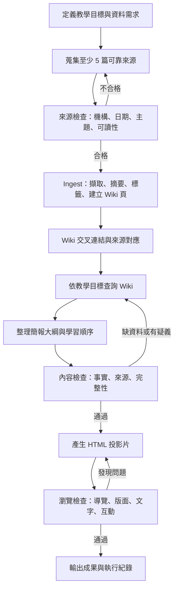

# Loop / Graph 設計說明

## Graph 流程

## 節點輸入與輸出
| 節點 | 輸入 | 輸出 | 檢查 |
|---|---|---|---|
| 來源蒐集 | 主題、教學問題 | 來源清單 | 至少 5 篇；優先官方或大學機構 |
| Ingest | 網頁／文件 | Wiki 摘要頁 | 來源與摘要是否相符 |
| Wiki 整理 | 多篇 Wiki 頁 | 標籤、內部連結 | 是否重複、是否有孤立頁 |
| 查詢 | 教學大綱需求 | 相關段落與來源 | 每個重要知識點可追溯 |
| 內容檢查 | 簡報草稿 | 通過／退回 | 正確性、初學者可懂、無來源漂移 |
| HTML 生成 | 已檢查內容 | 投影片網站 | 導覽、響應式、互動及文字溢位 |

## 哪些步驟會重複？
1. **來源檢查 loop**：若來源無法開啟、來源權威性不足或與主題不符，退回重新蒐集。
2. **內容查詢 loop**：若 Wiki 沒有足夠資訊支撐某張投影片，回到 Wiki 查詢或補充來源，不直接猜測。
3. **HTML 修正 loop**：若瀏覽檢查發現導覽失效、文字超出或互動不工作，修正 HTML 後重新測試。

## 為什麼這樣設計？
把來源檢查放在 ingest 前，可避免錯誤資料進入知識庫；把事實與來源對應檢查放在簡報生成前，可減少 AI 自行補完或產生無根據資訊；HTML 生成後再做瀏覽測試，則能檢查內容正確但介面不可用的問題。這是具回饋路徑的 graph，而不是只執行一次的線性 prompt。
